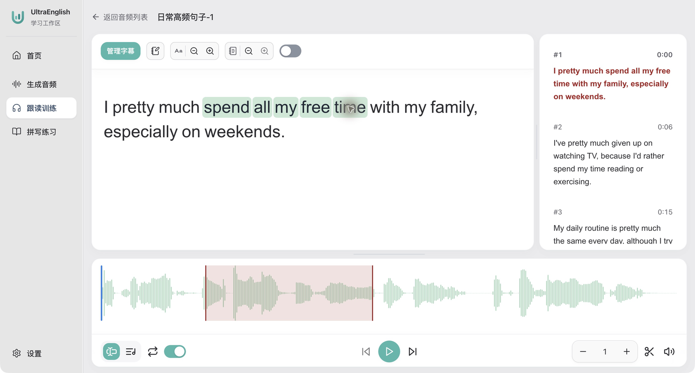

# UltraEnglish 英语学习桌面客户端

UltraEnglish 把英文文本和音频变成可以反复练习的学习素材。可以用自己的材料练听力和跟读，也可以打开词书按章节练习拼写。

**[访问官网](https://xrz-baizer.github.io/UltraEnglish/)** · [在线体验](https://xrz-baizer.github.io/UltraEnglish/#experience) · [下载 Mac 客户端](https://xrz-baizer.github.io/UltraEnglish/#download) · [问题反馈](https://github.com/xrz-baizer/UltraEnglish/issues)

## 核心功能

### 文本生成音频

在「生成音频」页输入或粘贴英文文本，选择音色、语速和输出格式，即可生成 MP3 或 WAV。首次使用时按提示下载 Kokoro 模型和音色，之后在本机合成。默认保存到系统下载目录，可在设置中调整模型存放位置和默认保存位置。生成后可以试听，也可以把音频和按原文生成的字幕一起导入音频资料库。

### 音频转文字

在首页选择「音频转文字」，导入自己的英文音频后点击「生成字幕」。UltraEnglish 使用本地 Whisper 识别英文语音并生成带时间戳的字幕。点击字幕可跳到对应的原声。

### 选段跟读

在「跟读训练」中打开一条素材。可以逐句跟读，也可以选中单词、短语或音轨中的一段，调整播放速度并循环跟读。导入自己的歌曲和歌词，也可以逐句跟唱。



### 单词拼写练习

在「拼写练习」中打开内置词书，按章节用键盘练习英文单词拼写。也可以导入自己的 JSON 词表。练习进度保存在本机，下次可以接着练。


## 第一次使用

1. 从官网下载适合 Apple 芯片 Mac 的安装包，打开 DMG，将 UltraEnglish 拖入「应用程序」。

   > 当前官网下载的 macOS 安装包未签名，首次打开时可能提示「应用已损坏」。安装后，在「终端」运行 `xattr -cr /Applications/UltraEnglish.app`，然后重新打开 UltraEnglish。

2. 在首页选「跟读训练」，打开内置的《日常高频句子-1》，点击一句字幕开始听，或选中几个词反复跟读。
3. 想使用自己的材料，可以在「生成音频」里粘贴英文文本，也可以从「音频转文字」导入现成的英文音频。想练单词时，从「拼写练习」选一本词书开始。

### 使用自己的学习素材

转录和纯文本字幕对齐使用 FFmpeg。用 Homebrew 的 Mac 可运行 `brew install ffmpeg`。仓库包含 Whisper tiny 模型及两种 Mac 架构的识别引擎。「生成音频」导出 MP3 也需要支持 `libmp3lame` 的 FFmpeg，编码失败时可把本次结果改存 WAV。

自定义词库使用 JSON 数组。每项用 `name` 填写英文原文，用 `trans` 保存中文释义数组。

```json
[
  { "name": "curiosity", "trans": ["n. 好奇心；求知欲"] }
]
```

## 问题反馈

遇到问题或有功能建议，可以在 GitHub [查看已有 Issue](https://github.com/xrz-baizer/UltraEnglish/issues) 或 [提交新 Issue](https://github.com/xrz-baizer/UltraEnglish/issues/new)。反馈问题时，欢迎附上客户端版本、系统版本和复现步骤。

## 本地启动

准备 Node.js 22.x 和 npm。在包含客户端 `package.json` 的目录中执行以下命令。

```bash
npm ci
npm run dev
```

首次启动会创建本地数据库并导入内置词库。如果启动时提示 `sqlite3` 的 `NODE_MODULE_VERSION` 不匹配，关闭客户端，运行 `npm run rebuild` 后重新启动。

## 制作安装包

`npm run make` 会构建最新源码、打包应用并制作安装包，一条命令即可。使用 Yarn 时可运行 `yarn make`，参数直接跟在后面。两种写法调用同一脚本，脚本内部会用到 npm。首次为某个架构打包时，Forge 会下载对应的 Electron 运行时，之后通常会复用缓存。

### macOS 安装包（DMG）

在 Mac 上按目标芯片选择一组命令。Forge 默认将两种架构的安装包都写入 `out/make/UltraEnglish.dmg`，下面在每次成功后立即改名，方便同时保留两份。

```bash
# Apple Silicon（M 系列）
npm run make -- --arch=arm64 && mv out/make/UltraEnglish.dmg out/make/UltraEnglish-arm64.dmg

# Intel Mac
npm run make -- --arch=x64 && mv out/make/UltraEnglish.dmg out/make/UltraEnglish-x64.dmg
```

Apple Silicon Mac 可以指定 Intel 目标。发布前请在对应架构上打开 DMG，将应用拖入「应用程序」，验证启动、词库读取和音频转录。当前配置尚未包含完整的 Developer ID 签名与公证流程。Mac App Store 分发另见[发布手册](docs/mac-app-store-release.md)。

### Windows 安装包（EXE）

在 Windows x64 电脑或 GitHub Actions 的 Windows 运行器中，进入客户端目录后执行：

```powershell
npm ci
npm run make -- --platform=win32 --arch=x64
```

生成的 `*Setup.exe` 位于 `out/make/squirrel.windows/x64/`。同一条打包命令用 Yarn 写作 `yarn make --platform=win32 --arch=x64`。

`win32` 是 Windows 平台名。若要尝试 32 位构建，运行 `npm run make -- --platform=win32 --arch=ia32`；该目标的原生依赖兼容性仍待验证。当前使用的 [Squirrel.Windows 安装器](https://www.electronforge.io/config/makers/squirrel.windows) 官方支持在 Windows 或装有 Mono 和 Wine 的 Linux 上制作。

正式分发前，请替换 [Forge 配置](forge.config.js) 中的示例图标地址。在干净的 Windows 机器上检查安装与启动，并为音频转录配齐 Windows 版 Whisper 引擎和 FFmpeg。

### 应用目录与版本号

只需测试打包后的应用目录时，运行 `npm run build`，再运行 `npm run package`。源码构建产物位于 `app-build/`，打包后的应用目录位于 `out/`。

应用版本来自 [package.json](package.json) 的 `version` 字段。例如发布 1.0.0 时，先运行 `npm version 1.0.0 --no-git-tag-version`，再执行对应平台的打包命令。`electron-forge make --version` 用于查看工具版本。

## 数据与备份

词库、练习进度和字幕保存在 Electron 用户数据目录下的 `data/ultra-english.db`，部分偏好和笔记保存在 localStorage。备份时先退出应用，复制整个用户数据目录，并保留单独设置的音频和模型目录。

生成音频与语音转录在本机处理。下载 Kokoro 资源或 Whisper 模型需要联网，首次使用文本对齐也可能下载所需资源。在线发音会将朗读文本发送至有道。

## 开发与第三方资源

提交客户端代码前可运行 `npm run typecheck` 和 `npm run build`。代码结构与开发约定见[客户端开发指南](ruler/README.md)。

音频学习和拼写练习分别参考了 [Enjoy](https://github.com/ZuodaoTech/everyone-can-use-english) 与 [qwerty-learner-vscode](https://github.com/RealKai42/qwerty-learner-vscode)。分发时请核对词库、模型、FFmpeg 和其他随包依赖的许可，尤其是用于文本对齐的 Echogarden（GPL-3.0）。随包 Whisper 引擎的许可见 [LICENSE](assets/bin/whisper/LICENSE)。
