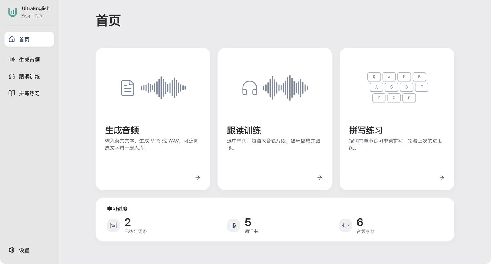
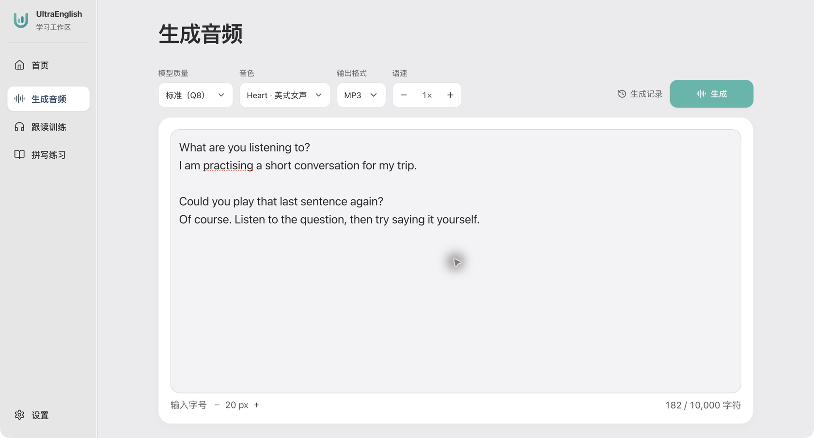
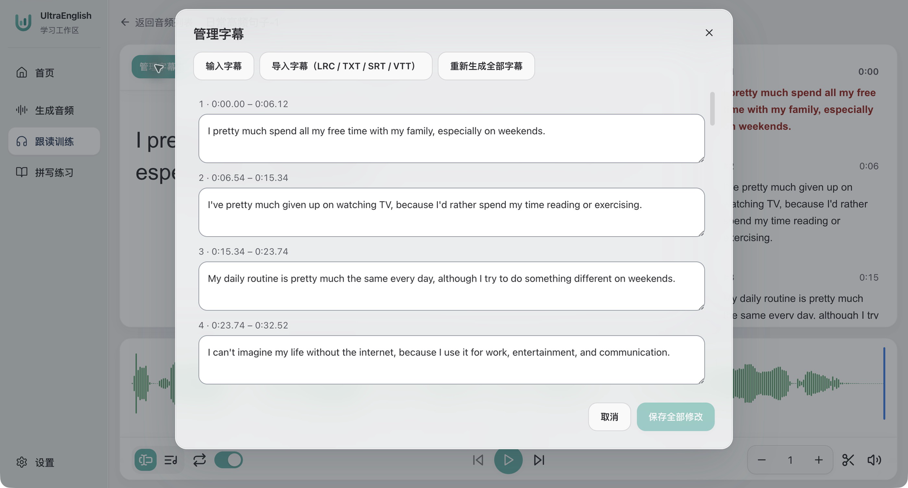
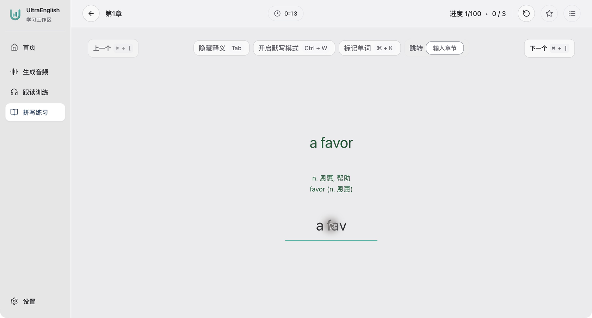

# UltraEnglish 英语学习桌面客户端

UltraEnglish 是一款在本机生成英语学习素材、练听力跟读和单词拼写的桌面应用。

**[访问官网](https://xrz-baizer.github.io/UltraEnglish/)** · [在线体验](https://xrz-baizer.github.io/UltraEnglish/#experience) · [下载 Mac 客户端](https://xrz-baizer.github.io/UltraEnglish/#download) · [问题反馈](https://github.com/xrz-baizer/UltraEnglish/issues)

## 核心功能

- **文本生成音频**：将英文文本合成为 MP3 或 WAV，支持多种音色和语速，音频可连同原文字幕一起保存到资料库。
- **音频转文字**：在本机识别英文录音，生成带时间戳的字幕，也支持导入 LRC、TXT、SRT 和 VTT。
- **选段跟读**：按句听原声，或选中单词、短语和波形片段，变速循环跟读。
- **单词拼写**：使用内置或自定义词书按章练习，支持填空、默写、熟词标记和进度保存。

## 应用截图

<table>
  <tr>
    <td width="33%" align="center"><a href="docs/screenshots/desktop-home.png"></a><br>首页</td>
    <td width="33%" align="center"><a href="docs/screenshots/audio-generation.png"></a><br>生成音频</td>
    <td width="33%" align="center"><a href="docs/screenshots/audio-subtitles.png"></a><br>时间轴字幕</td>
  </tr>
  <tr>
      <td width="33%" align="center"><a href="docs/screenshots/audio-study.png"></a><br>选段跟读</td>
    <td width="33%" align="center"><a href="docs/screenshots/vocabulary-library.png"></a><br>词书</td>
    <td width="33%" align="center"><a href="docs/screenshots/spelling-practice.png"></a><br>拼写练习</td>
  </tr>
</table>

## 第一次使用

Mac 版适用于 Apple 芯片。打开 DMG 后，将 UltraEnglish 拖入「应用程序」。

> 当前安装包未签名。若首次打开提示「应用已损坏」，安装后在终端运行 `xattr -cr /Applications/UltraEnglish.app`，然后重新打开应用。

## 问题反馈

欢迎在 [GitHub Issues](https://github.com/xrz-baizer/UltraEnglish/issues) 提交问题或建议。客户端「设置 → 关于」也提供版本信息和反馈入口。

<details>
<summary>开发、打包与数据说明</summary>

## 本地启动

准备 Node.js 22.x 和 npm。在包含客户端 `package.json` 的目录中执行以下命令。

```bash
npm ci
npm run dev
```

首次启动会创建本地数据库并导入内置词库。如果启动时提示 `sqlite3` 的 `NODE_MODULE_VERSION` 不匹配，关闭客户端，运行 `npm run rebuild` 后重新启动。

## 制作安装包

`npm run make` 会构建最新源码、打包应用并制作安装包，一条命令即可。使用 Yarn 时可运行 `yarn make`，参数直接跟在后面。两种写法调用同一脚本，脚本内部会用到 npm。首次为某个架构打包时，Forge 会下载对应的 Electron 运行时，之后通常会复用缓存。

### macOS 安装包（DMG）

在 Mac 上按目标芯片选择一组命令。Forge 默认将两种架构的安装包都写入 `out/make/UltraEnglish.dmg`，下面在每次成功后立即改名，方便同时保留两份。

```bash
# Apple Silicon（M 系列）
npm run make -- --arch=arm64 && mv out/make/UltraEnglish.dmg out/make/UltraEnglish-arm64.dmg

# Intel Mac
npm run make -- --arch=x64 && mv out/make/UltraEnglish.dmg out/make/UltraEnglish-x64.dmg
```

Apple Silicon Mac 可以指定 Intel 目标。发布前请在对应架构上打开 DMG，将应用拖入「应用程序」，验证启动、词库读取和音频转录。当前配置尚未包含完整的 Developer ID 签名与公证流程。

### Windows 安装包（EXE）

在 Windows x64 电脑或 GitHub Actions 的 Windows 运行器中，进入客户端目录后执行：

```powershell
npm ci
npm run make -- --platform=win32 --arch=x64
```

生成的 `*Setup.exe` 位于 `out/make/squirrel.windows/x64/`。同一条打包命令用 Yarn 写作 `yarn make --platform=win32 --arch=x64`。

`win32` 是 Windows 平台名。若要尝试 32 位构建，运行 `npm run make -- --platform=win32 --arch=ia32`；该目标的原生依赖兼容性仍待验证。当前使用的 [Squirrel.Windows 安装器](https://www.electronforge.io/config/makers/squirrel.windows) 官方支持在 Windows 或装有 Mono 和 Wine 的 Linux 上制作。

正式分发前，请替换 [Forge 配置](forge.config.js) 中的示例图标地址。在干净的 Windows 机器上检查安装与启动，并为音频转录配齐 Windows 版 Whisper 引擎和 FFmpeg。

### 应用目录与版本号

只需测试打包后的应用目录时，运行 `npm run build`，再运行 `npm run package`。源码构建产物位于 `app-build/`，打包后的应用目录位于 `out/`。

应用版本来自 [package.json](package.json) 的 `version` 字段。例如发布 1.0.0 时，先运行 `npm version 1.0.0 --no-git-tag-version`，再执行对应平台的打包命令。`electron-forge make --version` 用于查看工具版本。

## 本地依赖与数据

转录和纯文本字幕对齐依赖 FFmpeg，MP3 导出需要 FFmpeg 支持 `libmp3lame`。

### 数据与备份

词库、练习进度和字幕保存在 Electron 用户数据目录下的 `data/ultra-english.db`，部分偏好和笔记保存在 localStorage。备份时先退出应用，复制整个用户数据目录，并保留单独设置的音频和模型目录。

生成音频与语音转录在本机处理。下载 Kokoro 资源或 Whisper 模型需要联网，首次使用文本对齐也可能下载所需资源。在线发音会将朗读文本发送至有道。

## 开发与第三方资源

提交客户端代码前可运行 `npm run typecheck` 和 `npm run build`。代码结构与开发约定见[客户端开发指南](ruler/README.md)。

音频学习和拼写练习分别参考了 [Enjoy](https://github.com/ZuodaoTech/everyone-can-use-english) 与 [qwerty-learner-vscode](https://github.com/RealKai42/qwerty-learner-vscode)。分发时请核对词库、模型、FFmpeg 和其他随包依赖的许可，尤其是用于文本对齐的 Echogarden（GPL-3.0）。随包 Whisper 引擎的许可见 [LICENSE](assets/bin/whisper/LICENSE)。

</details>
